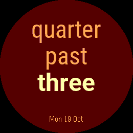
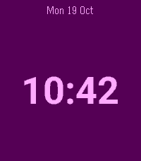

# Wordish

Time in words. Exact when you need it.

Wordish (formerly Fuzzy Text Two) gives the classic Pebble word clock crisp text and colourful
personalisation. Read relaxed time at a glance, double tap for the exact time,
and choose a discreet corner date or a colour preset to make it yours.
It supports classic Pebble watches as well as native layouts for Pebble Time 2
(Emery) and Pebble Round 2 (Gabbro).

The original watchface was designed around older 144x168 screens.  This
version adds sharper high-resolution text, larger bundled fonts for
modern displays, row/date colour customisation, and layout checks that keep the
words inside the screen even when languages, font choices, or round
displays make the text harder to fit.

This project is originally based on the [PebbleTextWatch][] by Mihai
Dumitrache, which reproduced the look of the Text Watch that comes
standard with the [Pebble][].

[Pebble]: https://getpebble.com/
[PebbleTextWatch]: https://github.com/wearewip/PebbleTextWatch

Mattias Bäcklund created a modified version, [Swedish fuzzy text
watch][], that displays fuzzy time.  Mattias wanted to combine the
elegant layout and animations of the Text Watch with the natural
language of the Fuzzy Time watchface, and wanted it in his native
language, Swedish.

[Swedish fuzzy text watch]: https://github.com/Sarastro72/Swedish-Fuzzy-Text-watch

This version builds upon the work by Mihai and Mattias by carrying the
old watchface forward for current Rebble/PebbleOS development.

Features:

 - Mobile-friendly settings with live colour previews, optional fine-tuning and undo
 - Fuzzy time in natural language
 - Modern PebbleOS target support, including Emery and Gabbro
 - Smoothed Roboto word rendering on Pebble Time 2 and Pebble Round 2
 - Larger text on newer screens without relying on bitmap scaling
 - Fit-safe line breaking across one to four lines of text
 - Automatic fallback to smaller font tiers when a line would overflow
 - Foreground and background colour customisation
 - Optional separate colours for minute row one, minute row two, hour row, and corner date sections
 - Font presets and coordinated Lagoon, Ember, Orchid, Grove and Sand colour styles
 - Optional small corner date with compact numeric and abbreviated formats
 - Double tap gesture to briefly show the exact digital time
 - Optional animation and double-tap controls, with 3, 5 or 10 seconds of exact time
 - Optional low-battery and phone-disconnection indicators
 - Nice staggered animation
 - Multiple languages inherited from the original international face

Screenshots
-----------

The [Wordish store package](store/1.6.2/README.md) includes the native 720×320
banner, five upload-ready screenshots for every supported platform, two native app icons
and the listing copy.

Release 1.6.2 gallery, captured directly from the Emery and Gabbro emulators:

| Time in words | Make it yours | A discreet date | Exact when needed |
| --- | --- | --- | --- |
|  |  |  |  |

The [capture helper](scripts/capture_screenshots.py) records bundle and source
hashes alongside the raw images in ignored `build/screenshots/`. Only the current
store gallery is kept in Git. It also checks double tap, return to fuzzy time
and the gesture-off setting on all seven platforms. These are emulator results;
physical display contrast and battery life still need device measurement.

The following options can be configured, using the Pebble app on your
phone:

- Font preset
- Visual preset, including colour and corner date showcase presets
- Foreground and background colours
- Minute row one, minute row two, hour row, and date section text colours
- Text alignment (centred, left, or right)
- Optional corner date, shown at the top or bottom with up to three coloured sections
- Corner date format (`dd-mm-yy`, `mm-dd-yyyy`, `Mon 3 Aug`, `dd/mm`, or `mm/dd`)
- Language
- Animate time changes on/off
- Double tap for exact time on/off, with a 3, 5 or 10 second display duration
- Low battery indicator (20% or less, hidden while charging)
- Phone-disconnection indicator

Double tap the watch to show the exact digital time for a few seconds.
The exact time follows the watch's 12-hour or 24-hour clock setting, then
the display returns to the fuzzy text face automatically. Animations and double
tap are enabled by default; both status indicators are off by default. Disabling
double tap unsubscribes from gestures. Indicators respond to battery/connection
events and do not add second-by-second updates or vibrations. Space is reserved
for enabled, visible indicators and the date, so long phrases may use smaller text.

Settings include an illustrative colour preview and a warning when text has
low contrast against its background. The preview does not reproduce the watch's
fonts, language or screen geometry. Manual style changes are labelled as custom;
date controls become available when the corner date is enabled. Existing legacy
inverted colours are preserved when opening and saving settings.

Style presets preserve animation, gesture and indicator preferences. If delivery
fails, the phone retries twice after one and two seconds, keeping newer saves
ahead of old retries. Settings remain saved for the next launch if all attempts fail.

Development checks
------------------

Run `make misc_checks` for the host C layout, word-conversion and watchface
callback tests, plus the Node.js configuration tests. Run `make lint` for the
seven-platform Pebble SDK build. The callback tests use a small SDK model;
they do not replace watch or emulator validation.

The [1.6.2 release plan](RELEASE_1.6.2.md) contains the proposed store description,
screenshot order and publishing checks. The app UUID, configuration URL and
saved-settings key remain unchanged across the rename.

At this time the included languages are:

- Catalan
- English
- French
- German
- Norwegian
- Spanish
- Swedish

Authorship
----------

Wordish is maintained by [gloriousCode][gloriousCode].  This
modernised version updates the old watchface for current PebbleOS
targets, adds colour customisation, and improves text resolution on
newer screens.

[gloriousCode]: https://github.com/gloriousCode

Acknowledgements
----------------

Thanks to the people whose earlier work made this watchface possible:

- [Mihai Dumitrache][Mihai], implemented an open source version of Text Watch
- [Mattias Bäcklund][Mattias], created Swedish fuzzy text watch
- [Jesse Hallett][Jesse], added earlier configuration options and multiple language support
- [Filip Horvei][iFlips], provided Norwegian translation
- Tomi De Lucca, discovered fix for a severe iOS bug & assisted with Spanish translation

[Mihai]: https://github.com/mmdumi
[Mattias]: https://github.com/Sarastro72
[Jesse]: https://github.com/hallettj
[iFlips]: https://github.com/iFlips

Contributing
------------

If you would like to request a translation, provide a translation, or
point out errors in a translation, please [open an issue][issue].

[issue]: https://github.com/gloriousCode/fuzzy-text-two/issues/new

For an example of what is needed for translations, take a look at
[`strings-en.c`][en].  In case you want to implement a translation
yourself, look at [818e076][es] to see all of the code changes that are
necessary to do so.

[en]: https://github.com/gloriousCode/fuzzy-text-two/blob/master/src/strings-en_GB.c
[es]: https://github.com/gloriousCode/fuzzy-text-two/commit/818e07686761adc00245986f6d389076534a5c1a

Please feel free to open issues for matters other than translations!
Pull requests are welcome as well.
