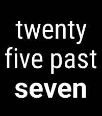
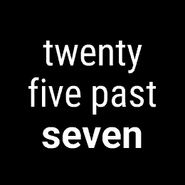
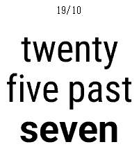
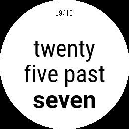
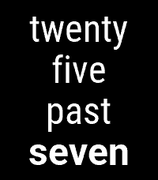
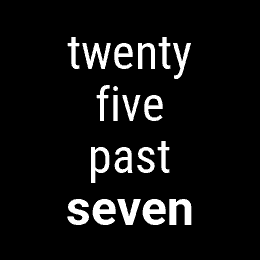
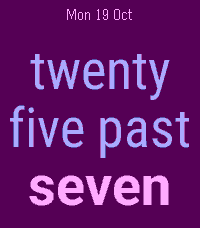
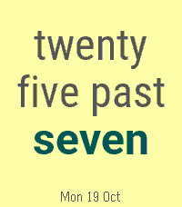

# Preset verification — Wordish 1.6.0

All eight settings presets captured directly from Time 2 (Emery, 200×228) and
Round 2 (Gabbro, 260×260), using the same final bundle as the store gallery.
Images are original emulator pixels. Each platform manifest records its settings,
source and bundle hashes. No physical-display or battery-life claim is made.

The old Ocean, Berry, Traffic, Candy, Terminal, Festival and Arcade presets have
been replaced. Existing saved colours remain supported; users can select a new
preset without losing language, animation, gesture or indicator preferences.

The new colours are exact entries in Pebble's 64-colour palette. Lagoon pairs
cool analogous tones with a cream accent; Ember uses analogous warm colours;
Orchid pairs violet and rose; Grove combines green and mint with cream; Sand
uses a warm neutral background with slate and a cool teal accent. The date uses
one quiet colour rather than competing coloured fragments.

Contrast ratios below describe solid text against its background. Antialiased
edge pixels are intentionally blended; the ratios do not certify a physical
watch display. Automated checks enforce 3:1 for large clock text and 4.5:1 for
small date text across every preset. Actual palette minima exceed those limits.

| Preset | Minimum clock contrast | Minimum date contrast | Time 2 | Round 2 |
| --- | --- | --- | --- | --- |
| Classic | 21.00:1 | Date off |  |  |
| Paper | 21.00:1 | 21.00:1 |  |  |
| Quiet | 21.00:1 | Date off |  |  |
| Lagoon | 7.59:1 | 7.59:1 |  |  |
| Ember | 8.03:1 | 8.03:1 |  |  |
| Orchid | 6.53:1 | 8.20:1 |  |  |
| Grove | 7.08:1 | 8.76:1 |  |  |
| Sand | 7.15:1 | 7.15:1 |  |  |

The large 48/54-pixel fonts use three native coverage masks, measured using their
full outer bounds. The long-phrase, exact-time, status and gesture checks remain
in [the release captures](../release-1.6.0). Small system-font fallbacks and date
text keep their original rendering.

Regenerate with `scripts/capture_screenshots.py --platform emery --preset-audit
--output screenshots/preset-audit-1.6.0` (on one line) and repeat for Gabbro, using
pebble-tool's Python. The helper reads presets from the actual settings page and
colour/protocol values from the phone bridge via `scripts/screenshot_presets.js`.
