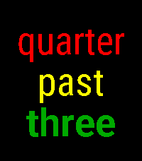
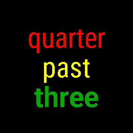
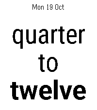
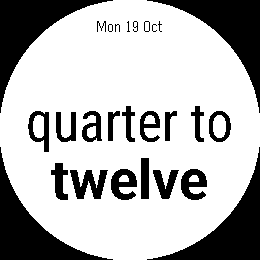
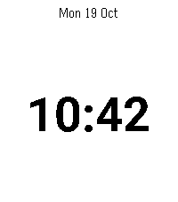
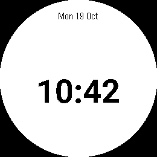
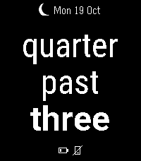
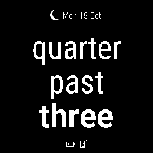

# Wordish store package

Prepared for version **1.6.0**, code **17**, using the existing app UUID
`bf4b4493-24d6-49e1-9388-4100aa55d9ba`. This package has not been published.

## Listing copy

- [Title](title.txt): Wordish.
- [Description](description.txt): complete, plain-text listing copy ready to paste.
- [Release notes](release-notes.txt): the 1.6.0 update summary, ready to paste.
- [Tagline](tagline.txt): included at the start of the description; also useful
  for announcements. It is not a separate required store field.

The existing listing is [Fuzzy Text Two](https://apps.repebble.com/fuzzy-text-two_a77242a455c04f94a667dbdf).
Rename that entry to Wordish and upload the release there, preserving its users
and hearts. Source: https://github.com/gloriousCode/fuzzy-text-two.

## Screenshots, in upload order

There are five images for each of the two modern platforms. Use the matching
folder for each platform's asset collection. The files contain original emulator
pixels with no scaling, added frames or promotional text. These images are from
the current Wordish 1.6.0 bundle; the older screenshots elsewhere in the repository
are not part of this upload selection.

| Order | Purpose | Pebble Time 2 — Emery, 200×228 | Pebble Round 2 — Gabbro, 260×260 |
| --- | --- | --- | --- |
| 1 | Time in words |  |  |
| 2 | Make it yours |  |  |
| 3 | A discreet date |  |  |
| 4 | Exact when needed |  |  |
| 5 | Useful details, quietly |  |  |

The fifth image shows the optional battery and phone-disconnection indicators,
plus the system Quiet Time indicator and date. These are deliberately enabled
for the showcase; battery and disconnection indicators default to off.
Long Catalan phrases and real gesture/timeout checks remain in
[`screenshots/release-1.6.0`](../../screenshots/release-1.6.0) for verification.

## Banner

Upload [wordish-banner.png](wordish-banner.png) for both platform collections.
It is exactly **720×320**, drawn directly at that resolution with the repository's
Roboto fonts. It is original promotional typography, not a watch screenshot.
No resizing, upscaling or downscaling was used. The larger AI-generated concepts
were not used in the final file.

The [current official submission requirements](https://developer.repebble.com/guides/appstore-publishing/preparing-a-submission/)
allow five screenshots per platform at exact screen dimensions, without watch
frames, and a 720×320 banner. The images here are PNG files below the 4.4 MB limit.

## Upload and verification

1. Publish the updated configuration page at its existing URL before the bundle.
   The local publishing branch is `master`; `git push origin master` requires
   separate approval.
2. Upload [`build/fuzzy-text-two.pbw`](../../build/fuzzy-text-two.pbw) as version
   1.6.0 to the existing listing. The retained filename does not affect the
   Wordish display name. The bundle is a build output, not checked into Git.
3. Apply the title, description and release notes, then the matching five
   screenshots and banner for Emery and Gabbro.
4. Check the store preview and download the published PBW to verify its name,
   version and UUID. The previous store download had mismatched version metadata.

[manifest.json](manifest.json) records the bundle hash, screenshot source paths,
capture times, dimensions and hashes, plus the banner hash. To regenerate this
selection after new captures, run `python3 scripts/prepare_store_assets.py` from
the repository with Pillow installed. The helper rejects stale source/bundle
provenance and draws the banner natively. It does not change the listing text.

The seven-platform SDK build and host tests pass. Emulator testing covers Time 2
and Round 2; physical watch contrast, battery life and phone-webview behaviour
have not been verified. See [the full release plan](../../RELEASE_1.6.0.md).
