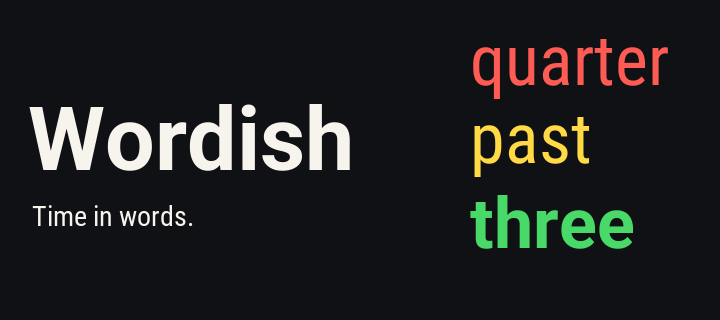
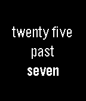
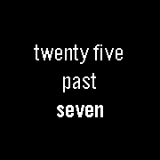
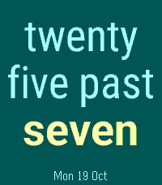

# Wordish store package

Prepared for version **1.6.2**, code **19**, using the existing app UUID
`bf4b4493-24d6-49e1-9388-4100aa55d9ba`. This package has not been published.

## Listing copy

- [Title](title.txt): Wordish.
- [Description](description.txt): complete, plain-text listing copy ready to paste.
- [Release notes](release-notes.txt): the 1.6.2 update summary, ready to paste.
- [Tagline](tagline.txt): included at the start of the description; also useful
  for announcements. It is not a separate required store field.

The existing listing is [Fuzzy Text Two](https://apps.repebble.com/fuzzy-text-two_a77242a455c04f94a667dbdf).
Rename that entry to Wordish and upload the release there, preserving its users
and hearts. Source: https://github.com/gloriousCode/fuzzy-text-two.

## Screenshots, in upload order

There are **35 screenshots: five for each of the seven platform tabs** in the
store. Use the folder matching the selected tab. All screenshots contain
original emulator pixels with no scaling, added frames or promotional text.

| Store tab | Folder | Native size | Preview |
| --- | --- | --- | --- |
| Pebble Classic | [aplite](aplite) | 144×168 |  |
| Pebble Time | [basalt](basalt) | 144×168 |  |
| Pebble Time Round | [chalk](chalk) | 180×180 |  |
| Pebble 2 | [diorite](diorite) | 144×168 |  |
| Pebble Time 2 | [emery](emery) | 200×228 |  |
| Pebble 2 Duo | [flint](flint) | 144×168 |  |
| Pebble Round 2 | [gabbro](gabbro) | 260×260 |  |

Upload these five filenames in order from each folder:

| Order | Filename | Purpose |
| --- | --- | --- |
| 1 | `01-time-in-words.png` | Clear, relaxed time |
| 2 | `02-make-it-yours.png` | Row colours on colour screens; font, alignment and inversion on monochrome screens |
| 3 | `03-corner-date.png` | A discreet date |
| 4 | `04-exact-time.png` | Exact time on demand |
| 5 | `05-status-indicators.png` | Useful details, quietly |

These images are from the current Wordish 1.6.2 bundle. This directory is the
only maintained store package; generated verification images stay in ignored `build/`.

The fifth image shows low battery, the system Quiet Time indicator and date.
Emery, Flint and Gabbro also show phone disconnection. The four legacy emulators
must remain connected to retrieve screenshots, so their images do not show the
disconnected-phone icon. Battery and disconnection indicators default to off.
Long Catalan phrases and real gesture/timeout checks remain in
`build/screenshots/release-1.6.2` locally for verification.

Time 2 and Round 2 use the new coordinated presets in this order:

| Shot | Preset | Palette |
| --- | --- | --- |
| Time in words | Lagoon | Deep teal, ice and cream |
| Make it yours | Ember | Maroon, peach and cream |
| A discreet date | Sand | Cream, slate and deep teal |
| Exact when needed | Orchid | Plum, lavender and soft rose |
| Useful details, quietly | Grove | Forest, mint and cream |

The larger clock fonts are smoothed on these two models. All eight current
presets were rendered on both emulators. Generated preset checks live locally in
`build/screenshots/preset-audit-1.6.2/`. The other five platform galleries retain
their original styles and rendering.

## Banner

Upload [wordish-banner.png](wordish-banner.png) for every platform collection.
It is exactly **720×320**, drawn directly at that resolution with the repository's
Roboto fonts. It is original promotional typography, not a watch screenshot.
No resizing, upscaling or downscaling was used. The larger AI-generated concepts
were not used in the final file.

The [current official submission requirements](https://developer.repebble.com/guides/appstore-publishing/preparing-a-submission/)
allow five screenshots per platform at exact screen dimensions, without watch
frames, and a 720×320 banner. The images here are PNG files below the 4.4 MB limit.

## App icons

Use [wordish-icon-80.png](wordish-icon-80.png) for Small Icon and
[wordish-icon-144.png](wordish-icon-144.png) for Large Icon. Each is drawn directly
at its native 80×80 or 144×144 size with a bold W and the banner's three colour
accents. Neither icon is a resized copy of the other.

## Upload and verification

1. Publish the updated configuration page at its existing URL before the bundle.
   The local publishing branch is `master`; `git push origin master` requires
   separate approval.
2. Upload [`build/fuzzy-text-two.pbw`](../../build/fuzzy-text-two.pbw) as version
   1.6.2 to the existing listing. The retained filename does not affect the
   Wordish display name. The bundle is a build output, not checked into Git.
3. Apply the title, description and release notes, then the matching five
   screenshots and the shared banner for all seven tabs, then the two app icons.
4. Check the store preview and download the published PBW to verify its name,
   version and UUID. The previous store download had mismatched version metadata.

[manifest.json](manifest.json) records the bundle hash, screenshot source paths,
capture times, dimensions and hashes, plus the banner and icon hashes. To regenerate this
selection after new captures, run `python3 scripts/prepare_store_assets.py` from
the repository with Pillow installed. The helper rejects stale source/bundle
provenance and draws the banner and icons natively. It does not change the listing text.

The seven-platform SDK build and host tests pass. Emulator testing covers all
seven platforms; physical watch contrast, battery life and phone-webview behaviour
have not been verified. See [the full release plan](../../RELEASE_1.6.2.md).
